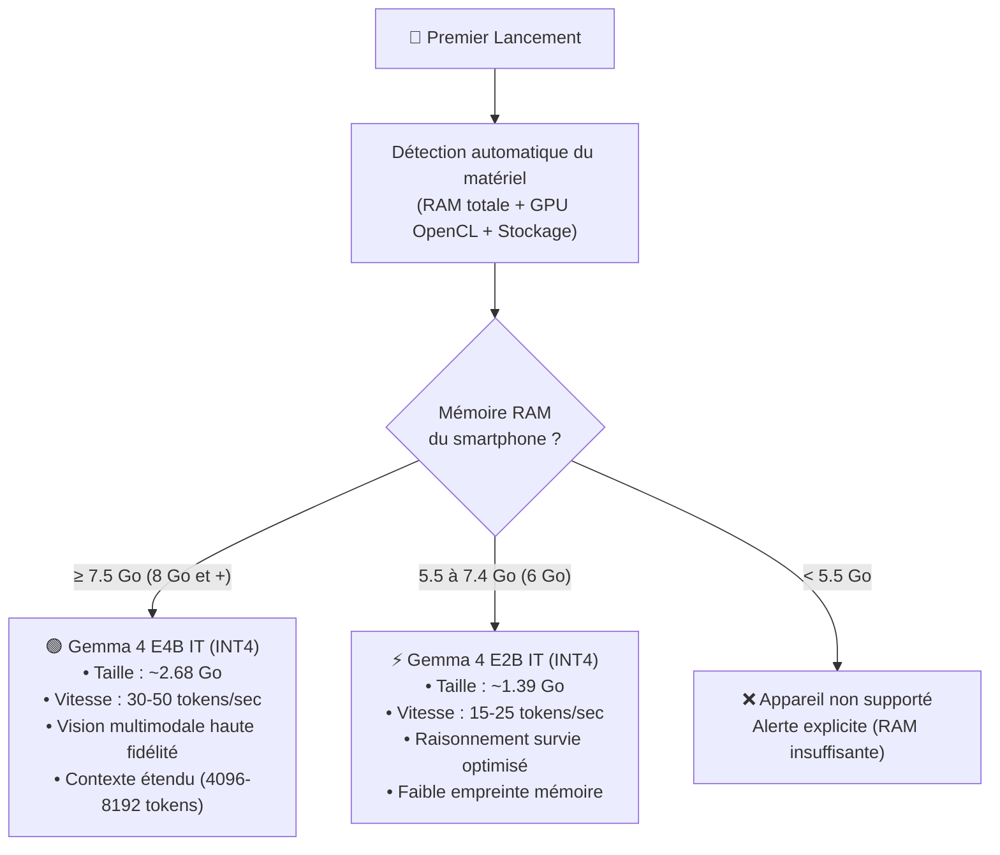

# 🧭 SurvIA — Agent IA de Survie 100% Hors-Ligne Mobile

[-38BDF8)](https://github.com/marequete/SurvIA)

> 🚀 **Liens Rapides :**  
> 📥 **[Télécharger directement SurvIA.apk (v1.0.1 • 12 Mo)](https://github.com/marequete/SurvIA/releases/latest/download/SurvIA.apk)**  
> 🌐 **[Ouvrir le Portail Web & QR Code](https://prompt-maple-f93df8x.tmp.now)**  
> 📦 **[Consulter les Releases GitHub](https://github.com/marequete/SurvIA/releases)**

**SurvIA** est un assistant de survie autonome propulsé par les modèles d'intelligence artificielle on-device **Google Gemma 4**, conçu pour fonctionner sans aucun accès au réseau Internet, sans carte SIM et sans relais cellulaire.

L'ensemble de l'inférence (texte, vision, réflexion et appels d'outils) ainsi que les bases de connaissances encyclopédiques et cartographiques s'exécutent directement sur le processeur (CPU), le GPU et le NPU de votre smartphone.

---

## 📱 Téléchargement et Installation Rapide

### Option A — Depuis un ordinateur (Scan QR Code)
1. Ouvrez le portail de distribution : **[Portail SurvIA](https://prompt-maple-f93df8x.tmp.now)**
2. Flashez le grand QR Code affiché à l'écran avec l'appareil photo de votre mobile.
3. Le téléchargement du fichier `SurvIA.apk` (~12 Mo) démarre immédiatement.
4. Ouvrez le fichier téléchargé pour installer l'application sur votre smartphone Android.

### Option B — Directement depuis votre smartphone
Téléchargez directement le binaire compilé officiel :  
👉 **[Télécharger SurvIA.apk (Dernière version stable)](https://github.com/marequete/SurvIA/releases/latest/download/SurvIA.apk)**

---

## ⚙️ Prérequis Matériels (Hardware Requirements)

| Prérequis | Minimum Requis | Recommandé (Confort & Rapidité) |
|---|---|---|
| **Système d'exploitation** | Android 8.0 Oreo (API 26) | Android 12, 13, 14 ou 15 |
| **Mémoire vive (RAM)** | **6 Go de RAM** | **8 Go à 12 Go de RAM** |
| **Espace de stockage** | **~2 Go d'espace libre** | **~4,5 à 5 Go d'espace libre** |
| **Capteurs requis** | Puce GPS matérielle | Puce GPS + Caméra photo (pour vision) |
| **Connexion Internet** | Requise **une seule fois** au 1ᵉʳ lancement (WiFi) | **0% réseau ensuite** (mode avion permanent) |

> ⚠️ **Important pour les appareils < 6 Go de RAM :**  
> Les smartphones disposant de moins de 6 Go de mémoire vive totale ne sont pas éligibles à l'inférence de modèles de langage locaux. L'OS Android (LMK - Low Memory Killer) forcerait la fermeture de l'application.

---

## 🧠 Sélection Automatique du Modèle ("Smart Model Selection")

SurvIA détecte automatiquement les capacités matérielles réelles de votre smartphone au premier lancement et sélectionne le modèle adapté **sans aucune configuration requise** :

### 🔍 Comment savoir quelle version est installée sur votre téléphone ?

Vous pouvez vérifier à tout moment quelle version est active grâce à plusieurs indicateurs visuels intégrés :

1. **Badge dans la barre supérieure de l'écran principal :**  
   - Si votre smartphone a 8 Go+ de RAM :  
     `● 0% Réseau • Gemma 4 E4B (INT4 mmap)` *(en vert)*
   - Si votre smartphone a 6 Go de RAM :  
     `● 0% Réseau • Gemma 4 E2B (INT4 mmap)` *(en cyan)*
2. **Premier message d'initialisation :**  
   Au démarrage, le premier message du chat de survie affiche le statut exact :  
   `"SurvIA initialisé avec succès en mode 100% hors-ligne (Gemma 4 E4B IT via mmap). Les 3 outils natifs sont actifs."`
3. **Notification permanente du service Sentinelle :**  
   Le service d'arrière-plan Android (`GemmaForegroundService`) maintient le modèle chaud en mémoire vive sans coupure et indique dans le volet de notifications le modèle actif.

---

## 🛠️ Les 3 Outils Function Calling Natifs

SurvIA n'invente rien : le modèle Gemma 4 dispose de 3 outils locaux natifs qu'il appelle automatiquement selon les situations :

### 1. `search_survival_kb` — Base de connaissances hors-ligne
- **Données :** Manuels de survie de l'US Army (FM 21-76), guide clinique d'urgence *Where There Is No Doctor*, et index des plantes sauvages.
- **Moteur :** SQLite FTS5 plein texte local (BM25).
- **Garde-fous stricts :** Détection et blocage systématique de la consommation de sosies mortels (Amanite phalloïde, Ciguë, If, etc.).

### 2. `get_gps_and_map` — Cartographie & Secours sans 4G
- **Données :** Puce GPS satellite native du téléphone.
- **Calculs :** Formule Haversine de distance réelle + estimation de temps de marche selon la règle de Naismith (pente et dénivelé).
- **Cartes :** Déclenchement automatique de l'application cartographique vectorielle hors-ligne via Intent `om://` (Organic Maps / MapLibre).

### 3. `analyze_camera_frame` — Vision et Triage Médical
- **Capacité :** Analyse directe des images prises par la caméra (sans envoyer l'image sur aucun serveur).
- **Protocoles :** Triage d'urgence MARCH (Massive bleeding, Airway, Respiration, Circulation, Hypothermia) et évaluation visuelle de terrain.

---

## 🔒 Confidentialité & Résilience Totale

- **0 octet envoyé :** Aucune télémétrie, aucune requête sortante, aucun compte utilisateur ni login.
- **Fonctionnement garanti en mode avion :** Testé et validé sans aucune connexion réseau active.
- **Résistant aux pannes d'énergie :** Cache de session et mmap persistant pour un redémarrage instantané.

---

## 📄 Licence

SurvIA est distribué sous licence open-source libre. Voir le fichier [LICENSE](LICENSE) pour plus de détails.
