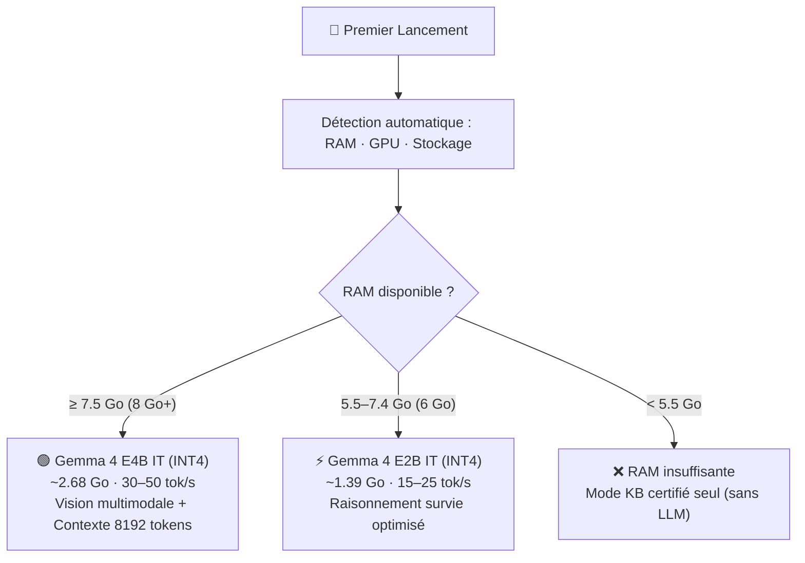

# 🧭 SurvIA — Agent IA de Survie 100% Hors-Ligne

[](https://github.com/marequete/SurvIA/actions/workflows/build-and-release.yml)
[](https://github.com/marequete/SurvIA/releases/latest)
[-38BDF8)](https://github.com/marequete/SurvIA)
[](https://github.com/marequete/SurvIA)
[](https://sonic-cypress-jl7xv8i-marequetes-projects.vercel.app/)

> 🚀 **Liens Rapides :**
> 📥 **[Télécharger SurvIA.apk (v1.2.0 · 23 Mo)](https://github.com/marequete/SurvIA/releases/latest/download/SurvIA.apk)**
> 🌐 **[Portail officiel & Licence Pro](https://sonic-cypress-jl7xv8i-marequetes-projects.vercel.app/)**
> 📦 **[Toutes les releases](https://github.com/marequete/SurvIA/releases)**

---

**SurvIA** est un assistant de survie autonome propulsé par **Google Gemma 4 on-device**, conçu pour fonctionner **sans réseau, sans carte SIM, sans cloud**. L'intégralité de l'inférence IA, des bases de connaissances médicales et des cartes s'exécutent directement sur le CPU/GPU/NPU de votre smartphone Android.

---

## ⚡ Démarrage Rapide

### A — Scan QR Code (depuis un ordinateur)
1. Ouvrez le **[Portail officiel SurvIA](https://sonic-cypress-jl7xv8i-marequetes-projects.vercel.app/)**
2. Flashez le QR Code affiché avec l'appareil photo de votre mobile
3. L'APK (`~23 Mo`) se télécharge directement — aucun Play Store requis

### B — Lien direct (depuis le smartphone)
👉 **[Télécharger SurvIA.apk](https://github.com/marequete/SurvIA/releases/latest/download/SurvIA.apk)**

> ⚠️ **Installation requise :** Autoriser les sources inconnues dans *Paramètres → Sécurité → Installer des apps inconnues*.

---

## 📋 Prérequis Matériels

| Critère | Minimum | Recommandé |
|---|---|---|
| OS Android | 8.0 Oreo (API 26) | Android 12–15 |
| RAM | 6 Go | 8 Go+ |
| Stockage libre | 2 Go | 4–5 Go |
| Capteurs | GPS matériel | GPS + Caméra |
| Internet | 1 fois au 1ᵉʳ lancement | Jamais ensuite |

> ⚠️ Moins de 6 Go de RAM = l'inférence LLM est désactivée. Les 7 bases certifiées restent entièrement accessibles (mode KB seul).

---

## 🧠 Architecture Technique

### Pipeline IA à 3 Étapes (Zero-Hallucination RAG)

```
Utilisateur → [Gemma : Analyse d'intention] → SearchSurvivalKB (7 bases certifiées)
                                                       ↓
                                           Protocole certifié brut
                                                       ↓
                              [Gemma : Traduction langage naturel strict]
                                                       ↓
                                        Réponse opérationnelle à l'utilisateur
```

1. **Amont — Analyse d'intention (Gemma)** : Gemma analyse la requête en langage naturel et extrait les mots-clés de domaine (hémorragie, eau, abri, morsure…) pour router vers la base certifiée exacte.
2. **Centre — Base Certifiée (SearchSurvivalKB)** : Les 7 référentiels médicaux et de survie délivrent le protocole brut exact. **Zero hallucination garantie.**
3. **Aval — Traduction (Gemma)** : Gemma reformule le protocole certifié en langage naturel clair et opérationnel, **sans jamais inventer** de dosage, coordonnée ou étape absente des données.

> 🛡️ **Garde-fou mortel absolu** : Pour toute question impliquant champignons, plantes sauvages ou baies, Gemma est **court-circuité** et le protocole de danger brut est affiché tel quel, sans aucune reformulation.

---

### Sélection Automatique du Modèle



---

## 🛠️ Les 3 Outils Natifs (Function Calling Hors-Ligne)

### 1. `search_survival_kb` — 7 Bases Médicales Certifiées
Sources embarquées dans l'APK, zéro connexion requise :
- **Where There Is No Doctor** (Hesperian Health Guides)
- **US Army Field Manual FM 21-76** (Survival)
- **Smart-FirstAid** — Protocoles premiers secours
- **WikiMed** — Encyclopédie médicale hors-ligne
- **SurvivalRAG** — Base RAG survie wilderness
- **kit-survie** (Soonz-38) — Techniques terrain françaises
- **SurvivalManual** — Protocoles shelter/feu/eau/navigation

**Domaines couverts :** hémorragie / garrot · arrêt cardiaque · étouffement / Heimlich · morsure de serpent / envenimation · plaies & désinfection naturelle · eau & purification · abri thermique & hypothermie · blackout & éclairage de fortune

### 2. `get_gps_and_map` — Navigation Sans 4G
- Puce GPS satellite native (fonctionne en mode avion complet)
- Calcul Haversine : distance réelle + estimation temps Naismith (pente)
- Carnet de terrain collaboratif : POI Eau / Danger / Itinéraire sécurisé
- Ouverture cartographie vectorielle hors-ligne (Organic Maps via `om://`)

### 3. `analyze_camera_frame` — Vision Médicale On-Device
- Analyse d'image directement sur le NPU (aucune image envoyée sur un serveur)
- Protocole MARCH : Massive bleeding · Airway · Respiration · Circulation · Hypothermia
- Évaluation visuelle de terrain en temps réel

---

## 🔐 Système de Licence Pro (v1.2.0)

SurvIA est **gratuit en téléchargement** (mode KB certifié seul). La **Licence Pro** débloque l'inférence Gemma complète (analyse d'intention + traduction langage naturel).

### Flux d'activation
```
Achat Stripe Checkout → Webhook → Token d'activation unique
       ↓
  QR Code affiché sur la page de confirmation
       ↓
  Scanner dans SurvIA → POST /api/activate
       ↓
  Certificat Ed25519 lié à l'empreinte matérielle (SHA-256)
       ↓
  Vérification 100% hors-ligne à chaque démarrage
```

### Sécurité de la Licence
| Composant | Mécanisme |
|---|---|
| **Identification appareil** | SHA-256(Build.FINGERPRINT · ANDROID_ID · Widevine DRM_DEVICE_UNIQUE_ID) |
| **Signature licence** | Ed25519 (compatible API 26–32 via `net.i2p.crypto:eddsa`, natif API 33+) |
| **Anti-repackaging** | Vérification SHA-256 du certificat de signature APK au démarrage |
| **Anti-instrumentation** | Détection su / Magisk / Frida / émulateur |
| **Backend** | Fly.io (CDG, always-on) + Neon PostgreSQL (persistant) |

---

## 🏗️ Architecture du Projet

```
SurvIA/
├── survia-app/                        # Application Android (KMP)
│   ├── androidApp/                    # Module Android (Compose)
│   │   ├── src/main/java/com/survia/android/
│   │   │   ├── MainActivity.kt        # Pipeline IA 3 étapes + UI Compose
│   │   │   ├── security/
│   │   │   │   ├── IntegrityGuard.kt  # Anti-tampering runtime
│   │   │   │   ├── HardwareBinding.kt # Empreinte matérielle SHA-256
│   │   │   │   └── LicenseManager.kt  # Vérification Ed25519 hors-ligne
│   │   │   ├── ai/
│   │   │   │   └── GemmaModelManager.kt # Chargement mmap + inférence
│   │   │   └── service/
│   │   │       └── GemmaForegroundService.kt # Sentinelle arrière-plan
│   │   ├── build.gradle.kts           # Dépendances + signingConfig Release
│   │   └── proguard-rules.pro         # R8 + règles eddsa + MediaPipe
│   └── shared/src/commonMain/kotlin/com/survia/
│       ├── tools/
│       │   ├── SearchSurvivalKB.kt    # 7 bases certifiées · Zero hallucination
│       │   ├── GetGpsAndMap.kt        # GPS Haversine + POI
│       │   ├── AnalyzeCameraFrame.kt  # Vision MARCH on-device
│       │   ├── SurvivalToolRouter.kt  # Routeur des outils
│       │   └── UserPoiStore.kt        # Carnet de terrain local
│       └── ai/
│           ├── GemmaModelManager.kt   # Interface KMP (Android)
│           └── PromptBuilder.kt       # Construction des prompts stricts
├── survia-backend/                    # Micro-service de licence
│   ├── index.js                       # Express · Stripe · Ed25519 · PostgreSQL
│   ├── fly.toml                       # Fly.io CDG · always-on
│   └── scripts/
│       ├── generate-ed25519-keys.js   # Génération clé Ed25519
│       └── migrate.js                 # Migration schema Neon PostgreSQL
├── landing-page/                      # Site vitrine & distribution
│   └── index.html                     # QR APK · Licence Pro Stripe · GPS POI
├── .github/workflows/
│   └── build-and-release.yml          # CI : assembleRelease signé + GitHub Release
└── README.md                          # Ce fichier
```

---

## 🚀 Build & CI

### GitHub Actions
Le workflow [build-and-release.yml](.github/workflows/build-and-release.yml) :
- **Si les secrets keystore sont configurés** → `assembleRelease` (R8 + ProGuard + signature) → APK publié sur GitHub Releases lors d'un tag `v*`
- **Sans secrets** → `assembleDebug` (fallback pour les PRs et tests)

### Secrets GitHub nécessaires pour `assembleRelease`
| Secret | Description |
|---|---|
| `ANDROID_KEYSTORE_BASE64` | Keystore `.jks` encodé en Base64 |
| `ANDROID_KEYSTORE_PASSWORD` | Mot de passe du keystore |
| `ANDROID_KEY_ALIAS` | Alias de la clé |
| `ANDROID_KEY_PASSWORD` | Mot de passe de la clé |
| `RELEASE_CERT_SHA256` | SHA-256 hex du certificat (64 chars, sans `:`) |

### Build local
```bash
cd survia-app
# Vérification syntaxe Kotlin
gradle :androidApp:compileDebugKotlin

# APK debug
gradle :androidApp:assembleDebug

# APK release (si keystore configuré localement)
ANDROID_KEYSTORE_PATH=/path/to/survia.jks \
ANDROID_KEYSTORE_PASSWORD=... \
ANDROID_KEY_ALIAS=survia \
ANDROID_KEY_PASSWORD=... \
gradle :androidApp:assembleRelease
```

---

## 🌐 Backend Licence (`survia-backend/`)

| Endpoint | Méthode | Description |
|---|---|---|
| `/api/health` | GET | Statut du service |
| `/api/create-checkout-session` | POST | Crée une session Stripe Checkout |
| `/api/license-token?session_id=` | GET | Récupère le token post-paiement |
| `/webhook/stripe` | POST | Reçoit les événements Stripe (checkout.session.completed) |
| `/api/activate` | POST | Lie le token à un hardware_id et signe le certificat Ed25519 |

**Déploiement :** `https://survia-license.fly.dev` (Fly.io CDG · always-on · Neon PostgreSQL)

---

## 🔒 Confidentialité & Résilience

- **0 octet envoyé** après activation : aucune télémétrie, aucune requête sortante
- **Mode avion permanent** : validé et testé sans aucune connexion réseau active
- **Résistant aux pannes** : cache mmap persistant, redémarrage à froid en < 3 s
- **Licence vérifiée 100% hors-ligne** : signature Ed25519 locale, sans appel réseau

---

## 📄 Licence

Le code source est distribué sous licence open-source. Voir [LICENSE](LICENSE).  
La **Licence Pro** (inférence Gemma) est commerciale — disponible sur le [portail officiel](https://sonic-cypress-jl7xv8i-marequetes-projects.vercel.app/).
