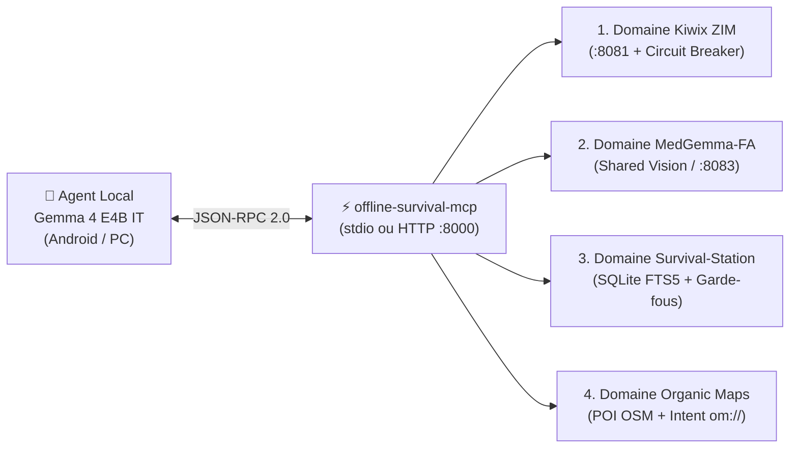

# 🧭 `offline-survival-mcp` — Serveur MCP Unifié de Survie 100 % Hors-Ligne (Android `Gemma 4 E4B IT` & PC)

Ce dépôt unifie **quatre projets open-source complémentaires** au sein d'un **seul serveur Model Context Protocol (MCP)** conçu pour fonctionner **100 % hors-ligne (*air-gapped*)**, optimisé spécifiquement pour tourner sur un **smartphone Android avec `Gemma 4 E4B IT`** (via Termux / boucle locale `127.0.0.1`) ainsi que sur PC Windows/Linux/macOS :

1. 📚 **[`jeffreyrampineda/kiwix-wiki-mcp-server`](https://github.com/jeffreyrampineda/kiwix-wiki-mcp-server.git)** — Recherche et extraction plein-texte dans les encyclopédies hors-ligne `.zim` via `kiwix-serve` (Wikipédia, WikiMed, iFixit, Wikibooks, StackExchange) avec nettoyage HTML économe en tokens.
2. 🩺 **[`sarbabi/MedGemmaImpactChallenge`](https://github.com/sarbabi/MedGemmaImpactChallenge.git)** — Assistant de premiers secours **MedGemma-FA** : arbre de triage médical d'urgence (**MARCH / ABCDE**), détection des drapeaux rouges et analyse multimodale de photos de blessures/brûlures/morsures.
3. 🛡️ **[`JoshKappler/survival-station`](https://github.com/JoshKappler/survival-station.git)** — Base de connaissances **SQLite FTS5 (BM25)** des manuels de survie (*Where There Is No Doctor*, *US Army FM 21-76*, radio/solaire), serveur de tuiles cartographiques **PMTiles** en Python pur (`HTTP 206 Byte-Range`) et **garde-fous vitaux** interdisant à l'IA de déclarer une plante ou un champignon sauvage comestible.
4. 🗺️ **[`organicmaps/organicmaps`](https://github.com/organicmaps/organicmaps.git)** — Recherche géospatiale hors-ligne de points d'intérêt vitaux (sources d'eau potable `natural=spring`, refuges, grottes, hôpitaux), calcul d'itinéraire pédestre (formule de Naismith + azimut boussole) et **pont natif Android Intent (`om://` / `geo:`)** ouvrant directement l'application Android **Organic Maps**.

---

## 🏗️ Architecture & Optimisation Mobile (`Gemma 4 E4B IT` sur Android)



### Pourquoi le mode `shared_vision` est-il décisif sur Android ?
Sur un smartphone Android (8 à 12 Go de RAM), charger deux modèles de 4 milliards de paramètres simultanément (`Gemma 4 E4B IT` + `MedGemma-4B-IT`) saturerait la mémoire vive (*Android LowMemoryKiller*).  
Par défaut (`MEDGEMMA_MODE=shared_vision`), l'outil `medical_analyze_injury_image` prépare la **grille clinique dermatologique/traumatologique MedGemma-FA** et les références médicales hors-ligne afin que **`Gemma 4 E4B IT`** (qui est nativement multimodal Vision + Texte) réalise lui-même l'inspection visuelle avec **0 Mo de RAM supplémentaire**. Si un second serveur `llama-server` MedGemma tourne (`MEDGEMMA_MODE=dedicated_medgemma`), le serveur MCP peut également l'interroger avec bascule automatique (*Circuit Breaker*).

---

## 🛠️ Les 12 Outils MCP Exposés

| Domaine | Outil MCP | Rôle |
| :--- | :--- | :--- |
| **1. Kiwix ZIM** | `kiwix_list_libraries` | Liste les archives `.zim` actives sur `kiwix-serve` ou le catalogue de survie embarqué. |
| **1. Kiwix ZIM** | `kiwix_search` | Recherche d'articles dans Wikipédia, WikiMed, iFixit avec bascule automatique SQLite FTS5 si `kiwix-serve` est éteint. |
| **1. Kiwix ZIM** | `kiwix_get_article` | Extrait et nettoie un article `.zim` en texte pur compact adapté au contexte mobile. |
| **2. Survie & Sécurité** | `survival_search_manuals` | Recherche plein-texte BM25/FTS5 dans les manuels (*US Army FM 21-76*, *Where There Is No Doctor*, réparation radio/solaire). |
| **2. Survie & Sécurité** | `survival_verify_edibility` | **Garde-fou obligatoire** : bloque toute validation d'ingestion de plante/champignon sauvage et liste les sosies mortels. |
| **2. Survie & Sécurité** | `survival_emergency_protocol` | Retourne une checklist d'urgence immédiate (`hypothermia`, `hemorrhage`, `water_purification`, `radio_distress`). |
| **3. MedGemma-FA** | `medical_triage_assessment` | Triage médical **MARCH / ABCDE**, détection des drapeaux rouges et contre-indications strictes. |
| **3. MedGemma-FA** | `medical_analyze_injury_image` | Analyse multimodale d'une photo de plaie/brûlure/morsure (`shared_vision` pour `Gemma 4 E4B IT` ou `dedicated_medgemma`). |
| **4. Organic Maps** | `geo_search_survival_poi` | Trouve les sources d'eau potable, refuges et hôpitaux hors-ligne dans un rayon en km (distance Haversine + cap boussole). |
| **4. Organic Maps** | `geo_compute_offline_route` | Calcule un itinéraire pédestre hors-ligne (distance sentier, azimut, dénivelé et durée selon la règle de Naismith). |
| **4. Organic Maps** | `geo_open_organic_maps` | Génère les liens `om://` / `geo:` et ouvre directement l'application Android **Organic Maps** (`app.organicmaps`) via `am start`. |
| **Système** | `system_health_status` | Diagnostic complet des bases SQLite, de `kiwix-serve`, du serveur PMTiles et de l'environnement Android. |

---

## 🚀 Démarrage Rapide

### Option A — Sur Smartphone Android (Termux + Gemma 4 E4B IT)
```bash
bash scripts/install_android_termux.sh
./start-android-mcp.sh
```

### Option B — Sur PC (Windows / Linux / macOS)
```bash
# 1. Générer / initialiser la base SQLite FTS5 et vérifier la santé du système
python scripts/start_survival_station.py --check-only

# 2. Lancer le serveur MCP en mode stdio (pour Claude Desktop / Client MCP / Agent)
node ./bin/mcp-server.mjs --transport stdio

# 3. Ou lancer en mode HTTP local (:8000) + Serveur de cartes PMTiles (:8082)
python scripts/start_survival_station.py --transport http
```

### Configuration Client MCP (`mcp-config.example.json`)
```json
{
  "mcpServers": {
    "offline-survival": {
      "command": "node",
      "args": ["./bin/mcp-server.mjs", "--transport", "stdio"],
      "env": {
        "TARGET_AGENT_MODEL": "gemma-4-e4b-it",
        "MEDGEMMA_MODE": "shared_vision",
        "KIWIX_SERVER_URL": "http://127.0.0.1:8081"
      }
    }
  }
}
```

---

## 🧪 Tests Automatisés

```bash
PYTHONPATH=src python -m unittest discover -s tests -v
```

---

## 📂 Structure du Dépôt

```text
├── .agents/skills/survie-hors-ligne-mcp/   # Compétence (Skill) en français pour l'agent IA
├── bin/mcp-server.mjs                      # Lanceur universel MCP (stdio / HTTP)
├── data/
│   ├── survival_knowledge.db               # Base SQLite3 (FTS5 manuels + garde-fous + POI OSM)
│   └── survival_knowledge_store.json       # Seed canonique hors-ligne
├── docs/superpowers/
│   ├── specs/2026-11-17-offline-survival-mcp-design.md
│   └── plans/2026-11-17-offline-survival-mcp.md
├── scripts/
│   ├── build_sqlite_db.mjs                 # Générateur SQLite FTS5 natif (node:sqlite)
│   ├── install_android_termux.sh           # Installateur Android Termux + Gemma 4 E4B IT
│   └── start_survival_station.py           # Orchestrateur hors-ligne (MCP + PMTiles)
├── src/offline_survival_mcp/
│   ├── config.py                           # Configuration & détection Android/Termux
│   ├── server.py                           # Serveur MCP JSON-RPC 2.0 (12 outils + prompts)
│   ├── db/schema_and_seed.py               # Moteur hybride SQLite FTS5 / BM25
│   ├── domains/
│   │   ├── kiwix_domain.py                 # Intégration kiwix-wiki-mcp-server
│   │   ├── medgemma_domain.py              # Intégration MedGemmaImpactChallenge
│   │   ├── survival_domain.py              # Intégration survival-station + garde-fous
│   │   └── organicmaps_domain.py           # Intégration organicmaps + routage + Intent Android
│   └── services/pmtiles_server.py          # Serveur de tuiles PMTiles HTTP 206 en Python pur
├── tests/                                  # Suite complète de 12 tests unitaires et d'intégration
└── web/index.html                          # Poste de contrôle tactique + Boussole topographique 3D
```

