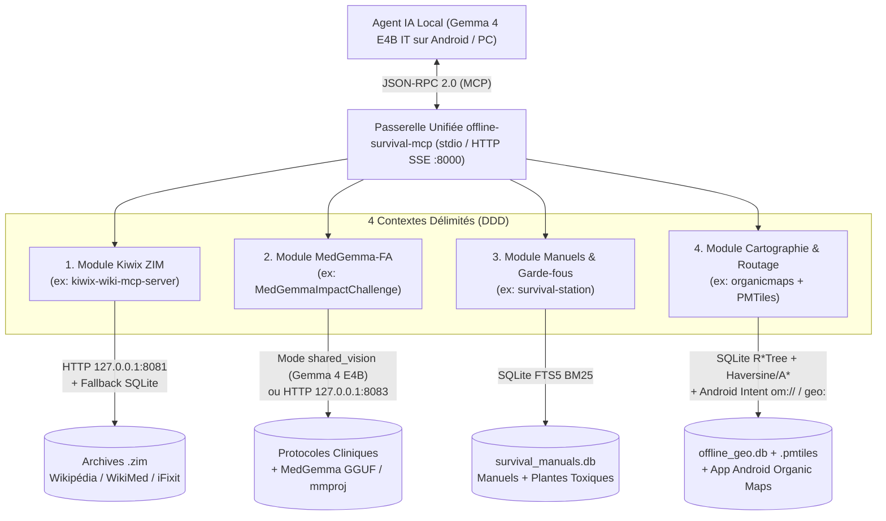

# Spécification Architecturale : Serveur MCP Unifié de Survie Hors-Ligne (`offline-survival-mcp`)

**Date :** 2026-11-17  
**Cible principale :** Smartphone Android (Termux / ARM64) avec **Gemma 4 E4B IT** & PC Air-Gapped (Windows / Linux / macOS)  
**Architecture :** Passerelle MCP Unifiée en Python (FastMCP / JSON-RPC 2.0 `stdio` & `HTTP/SSE`)  
**Dépôts unifiés :**
1. [`jeffreyrampineda/kiwix-wiki-mcp-server`](https://github.com/jeffreyrampineda/kiwix-wiki-mcp-server.git)
2. [`sarbabi/MedGemmaImpactChallenge`](https://github.com/sarbabi/MedGemmaImpactChallenge.git)
3. [`JoshKappler/survival-station`](https://github.com/JoshKappler/survival-station.git)
4. [`organicmaps/organicmaps`](https://github.com/organicmaps/organicmaps.git)

---

## 1. Contexte du Domaine & Objectifs (`backend-architect`)

En situation de survie ou d'isolement réseau (*air-gapped*), un agent IA local comme **Gemma 4 E4B IT** tournant sur un smartphone Android doit pouvoir répondre avec une fiabilité vitale à toute question portant sur :
- **Les premiers secours et le triage médical** (analyse visuelle de blessures, brûlures, morsures, posologies d'urgence).
- **Les procédures de survie vérifiées** (purification d'eau, abris, nœuds, signaux de détresse, réparation radio/solaire) avec des **garde-fous stricts** interdisant toute hallucination sur la comestibilité des plantes ou champignons sauvages.
- **La connaissance encyclopédique hors-ligne** (archives `.zim` via Kiwix : Wikipédia, WikiMed, iFixit, Wikibooks, StackExchange).
- **La géolocalisation, les points d'intérêt vitaux (POI) et le routage hors-ligne** (sources d'eau potable, refuges, hôpitaux, topographie et ouverture directe dans l'application Android **Organic Maps** ou via le serveur local de tuiles **PMTiles**).

### Exigences Non Fonctionnelles (NFR)
1. **Fonctionnement 100 % Hors-Ligne (Zero-Network Dependency) :** Tous les appels réseau s'effectuent exclusivement sur la boucle locale `127.0.0.1` ou sur des bases SQLite/fichiers locaux.
2. **Optimisation RAM Mobile (< 80 Mo pour le serveur MCP) :** Sur Android avec `Gemma 4 E4B IT`, le serveur MCP ne doit jamais provoquer de saturation mémoire (*Android LowMemoryKiller*). Le module médical fonctionne par défaut en mode **Mutualisation Vision (`shared_vision`)** où `Gemma 4 E4B IT` exécute l'analyse clinique structurée de *MedGemma-FA*, tout en permettant de basculer vers un démon `llama-server` (`MedGemma-4B-IT` GGUF) dédié (`dedicated_medgemma`) lorsque la RAM le permet.
3. **Résilience & Tolérance aux Pannes (Circuit Breaker & Graceful Degradation) :** Si `kiwix-serve` (`:8081`) ou `llama-server` (`:8083`) est indisponible, le serveur MCP bascule automatiquement sur la base **SQLite FTS5** embarquée et les protocoles médicaux pré-indexés sans jamais faire échouer l'agent.
4. **Portabilité Totale (Zéro dépendance PowerShell obligatoire) :** Le serveur de tuiles PMTiles de `survival-station` est implémenté en **Python pur** (requêtes HTTP `Range: bytes=...`) pour tourner à l'identique sur Android (Termux) et sur Windows/Linux.

---

## 2. Architecture DDD (Bounded Contexts) & Contrats MCP

### Contrats des 12 Outils MCP Exposés

| Domaine | Nom de l'outil MCP | Entrées (Schéma JSON) | Sortie & Comportement |
| :--- | :--- | :--- | :--- |
| **Kiwix** | `kiwix_list_libraries` | `{}` | Liste les bibliothèques `.zim` disponibles sur `kiwix-serve` (XML OPDS) ou dans le dossier local. |
| **Kiwix** | `kiwix_search` | `query: str, library?: str, limit: int = 5` | Recherche plein-texte dans `kiwix-serve` avec repli automatique sur l'index local SQLite si `kiwix-serve` est éteint. |
| **Kiwix** | `kiwix_get_article` | `url: str, max_chars: int = 4000` | Récupère l'article `.zim`, nettoie le HTML/CSS/JS et retourne un texte structuré économe en tokens. |
| **Survie** | `survival_search_manuals` | `query: str, category?: str, limit: int = 5` | Recherche plein-texte FTS5 (algorithme BM25) dans les manuels de survie (*Where There Is No Doctor*, *FM 21-76*, radio, eau, abris). |
| **Survie** | `survival_verify_edibility` | `specimen_name: str, characteristics?: str` | **Garde-fou critique** : croise la base botanique/fongique de sécurité. Bloque toute validation d'ingestion sauvage non certifiée et rappelle le test universel de comestibilité. |
| **Survie** | `survival_emergency_protocol` | `scenario: str` | Retourne le protocole d'urgence pas-à-pas vérifié (hémorragie, hypothermie, purification d'eau, feu, détresse radio). |
| **Médical** | `medical_triage_assessment` | `symptoms: str, age_group?: str, mechanism?: str` | Exécute l'arbre de triage *MedGemma-FA* (classification MARCH / ABCDE, drapeaux rouges, gestes de premiers secours). |
| **Médical** | `medical_analyze_injury_image` | `image_path: str, clinical_context?: str` | Vérifie et encode l'image de blessure ; en mode `shared_vision`, fournit la grille d'inspection dermatologique/traumatologique MedGemma à `Gemma 4 E4B IT` ; en mode `dedicated_medgemma`, interroge `llama-server` (`mmproj`). |
| **Cartes** | `geo_search_survival_poi` | `lat: float, lon: float, radius_km: float = 10.0, category?: str` | Recherche spatiale hors-ligne (eau potable, sources, refuges, hôpitaux, sommets) triée par distance Haversine et azimut. |
| **Cartes** | `geo_compute_offline_route` | `start_lat: float, start_lon: float, end_lat: float, end_lon: float, mode: str = "walk"` | Calcule la distance, le cap boussole initial, le dénivelé estimé, le temps de marche (formule de Naismith) et les points d'eau intermédiaires. |
| **Cartes** | `geo_open_organic_maps` | `lat: float, lon: float, label?: str, launch_intent: bool = True` | Génère les URI `geo:` et `om://` d'Organic Maps et, sur Android/Termux, déclenche `am start` pour ouvrir directement l'application Organic Maps hors-ligne. |
| **Système** | `system_health_status` | `{}` | Sonde de santé complète : état des bases SQLite FTS5/Geo, disponibilité de `kiwix-serve`, `llama-server`, serveur `PMTiles` et profil Android/Termux. |

---

## 3. Sécurité, Garde-fous et Observabilité

1. **Verrou Botanique & Fongique (`survival-station`) :** Toute réponse de `survival_verify_edibility` inclut un en-tête de sécurité non contournable interdisant à l'agent de confirmer qu'une plante ou un champignon sauvage est comestible sur simple description ou photo.
2. **Avertissement Clinique (`MedGemmaImpactChallenge`) :** Les outils médicaux intègrent les contre-indications critiques (ex. ne jamais retirer un objet fiché dans une plaie profonde, ne pas donner à boire à un blessé inconscient).
3. **Validation Stricte des Entrées :** Protection contre les injections SQL (requêtes paramétrées SQLite), validation des coordonnées GPS (`-90 <= lat <= 90`, `-180 <= lon <= 180`), et restriction d'accès fichiers pour `medical_analyze_injury_image`.

